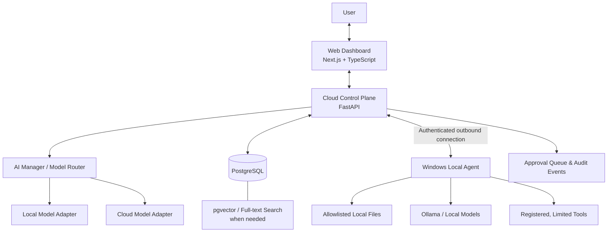

<!--
  R MATRIX PERSONAL AI COMMAND CENTER
  Repository README | Copy this file into the root of your GitHub repository.
-->

<!-- Animated header banner -->

<!-- Animated typing headline -->

  <strong>A hybrid personal AI operating system for chat, knowledge, documents, development, and automation.</strong>

  
  
  

  <a href="#-vision">Vision</a> ·
  <a href="#-planned-features">Features</a> ·
  <a href="#-architecture">Architecture</a> ·
  <a href="#-roadmap">Roadmap</a> ·
  <a href="#-privacy--security-principles">Security</a>

🧠 Vision
R Matrix Personal AI Command Center is a personal AI workspace built to bring conversations, important documents, project context, developer tools, and automation into one connected system.

Instead of maintaining several disconnected AI tools, the goal is to have one central assistant that understands a request, finds the relevant information, chooses the right model or tool, and returns a useful result—with clear user control over private data and consequential actions.
Core idea: One Intelligence. Your Entire Digital World.

Project status: This repository describes the intended architecture and implementation roadmap. Features are planned until they are implemented, tested, and documented here.

✨ Planned Features
Capability	What it is intended to do	Initial approach
💬 Unified AI Chat	Provide one place to talk to the assistant and access relevant project context	FastAPI chat API + model adapter
📚 Document Intelligence	Search selected files, summarize content, and answer questions with source references	Local file index + document parsers
🧠 Approved Memory	Remember useful preferences, decisions, and project context with user control	Explicitly approved memory records
🖥️ Windows Local Agent	Connect the dashboard to permitted local tools and files	Python companion with an authenticated outbound connection
🌐 Remote Web Dashboard	Access the command center through a browser when away from the PC	Next.js / React + TypeScript
🔀 Hybrid Model Router	Select local or cloud AI based on task, privacy, availability, and capability	Provider-neutral model interface
🧑‍💻 Developer & Project Assistant	Help inspect selected repositories, understand errors, and plan work	Restricted tools + project/task records
⚙️ Workflow Automation	Integrate approved workflows and external services	n8n + narrowly scoped webhooks, in a later phase
✅ Action Approval	Ask before consequential operations and record outcomes	Approval queue + task/audit records

🏗️ Architecture
The system is planned around two connected parts: a cloud control plane for the web dashboard and coordination, and a Windows local agent for work that should remain on your PC.

🧩 Main Components
- Web dashboard: chat, documents, project workspaces, task status, approvals, and settings.
- Cloud backend: authentication, API endpoints, orchestration, task tracking, and secure coordination.
- AI manager: classifies requests and chooses an appropriate model or registered tool.
- Windows local agent: accesses only configured folders and permitted local tools; it initiates the connection to the cloud service.
- Model adapters: provide a consistent interface for local inference and cloud AI APIs.
- Database and search: store application records, task states, approved memories, and optional cloud-approved knowledge.
🤖 Planned Agent Responsibilities
These are initially intended to be Python modules with clear input/output schemas—not multiple always-running autonomous systems.
1. Manager / Orchestrator
Understands the user's request, chooses the right workflow, coordinates specialist tools, and combines their results. It should distinguish plans from verified outcomes.
2. Documents & Knowledge Agent
Indexes approved folders, searches documents, extracts relevant passages, and provides source references such as filenames and page numbers where available.
3. Developer & Project Assistant
Works with selected repositories and project records to explain errors, review changes, summarize verified status, and suggest next steps.
4. Automation & Actions Agent
Prepares reports, creates task drafts, and later triggers approved n8n workflows or external integrations through restricted tools.
🔀 Hybrid Local + Cloud AI
The model router is intended to choose execution based on the request and the privacy policy.
Request	Preferred route
Search private files on the PC	Local index and local agent
Discuss sensitive document content	Local model by default
Complex reasoning or coding support	Cloud model when permitted
Work without internet access	Local model and available local tools
Remote operation involving PC files	Authenticated local-agent job, if the PC is online
Cloud-approved knowledge search	Cloud search and an allowed model

The local model runner is planned to use Ollama. Local model speed and quality will depend on the selected model and available hardware.
🔐 Privacy & Security Principles
Privacy and user control are core product requirements—not optional add-ons.
- 🔒 Local by default: private file contents stay on the PC unless the user explicitly permits cloud transfer or synchronization.
- 🗂️ Folder allowlist: the local agent can access only configured folders, not the entire computer by default.
- 🔑 No hardcoded secrets: API keys and device credentials must not be committed to Git.
- 🌐 Secure connectivity: the PC agent initiates an authenticated outbound connection; local services must not be exposed directly to the public internet.
- 🧾 Approval before action: writing or deleting files, running commands, sending messages, or changing external services requires explicit approval appropriate to the action.
- 🧱 Restricted tools: the cloud service must not be able to run arbitrary shell commands on the PC.
- 🛡️ Untrusted document content: instructions found inside a PDF, webpage, or retrieved text must never override system permissions.
- ✅ Verified status: an operation is not marked completed until its result has been checked.
- 📋 Auditability: important actions should record what happened without unnecessarily storing sensitive file contents.
- 🧠 User-controlled memory: the assistant should propose useful memories and save them only according to the configured approval policy.
🧰 Intended Technology Stack

  
  
  
  
  
  
  
  

Layer	Planned technology
Frontend	Next.js, React, TypeScript
Cloud API	Python, FastAPI
Windows companion	Python
Local inference	Ollama
Cloud inference	AI provider APIs through an adapter
Database	PostgreSQL
Semantic retrieval	pgvector, introduced when required
Initial local search	SQLite FTS5 / local index
Automation	n8n and scoped webhooks, later phase
Version control	Git and GitHub

🗺️ Roadmap
- [ ] Phase 0 — Foundation: inspect the workspace, establish repository conventions, configure environments, and add the initial application skeleton.
- [ ] Phase 1 — Local assistant: basic chat, local model adapter, document ingestion, local search, and source-grounded answers.
- [ ] Phase 2 — Remote dashboard: web UI, authentication, cloud API, secure device registration, and Windows-agent connectivity.
- [ ] Phase 3 — Memory & knowledge: approved memories, project workspaces, task history, and optional cloud-approved vector search.
- [ ] Phase 4 — Specialist tools: project assistance, limited actions, approval flows, and audit records.
- [ ] Phase 5 — Integrations: n8n workflows and carefully scoped external services.
- [ ] Phase 6 — Hardening & release: security tests, reliability checks, backup/restore plan, deployment documentation, and release checklist.
Roadmap checkboxes should be updated only when a milestone's acceptance tests pass and the result is verified.

📁 Intended Repository Layout
r-matrix-personal-ai-command-center/
├── frontend/                 # Next.js dashboard
├── backend/                  # FastAPI cloud API and orchestration
├── local-agent/              # Windows companion and permitted local tools
├── tests/                    # Unit and integration tests
├── docs/                     # Handoff guide, user guide, architecture, decisions
├── .env.example              # Safe configuration template; no real secrets
├── .gitignore
└── README.md
Create modules as each milestone requires them. Avoid adding empty files for features that are not yet being implemented.
🚀 Development Approach
Development is planned for Windows + PowerShell, using Cursor, GitHub Copilot, Git, and GitHub.
1. Read the project guides in docs/ before making architectural changes.
2. Implement one milestone at a time.
3. Inspect existing files before editing and preserve useful work.
4. Run relevant tests and report the exact commands and results.
5. Commit a working milestone before moving to the next one.
6. Never report a feature as working unless it has been implemented and verified.
Setup instructions will be added as the actual repository and application structure are created. Commands and environment variables should match the code in the current branch, not a future planned architecture.
📚 Project Documents
Keep these documents in the repository's docs/ directory:
- Personal_AI_Command_Center_Complete_Handoff_Guide.pdf — technical blueprint and implementation handoff.
- Personal_AI_Command_Center_Plain_Language_Guide_User_Agreement.pdf — product behavior, user expectations, privacy, and approval principles in plain language.
The plain-language user agreement is a project draft and should not be presented as a legally reviewed contract.
🎯 Long-Term Goal
Build a dependable, privacy-conscious personal AI workspace that can understand context, search personal knowledge, help with real projects, and carry out approved tasks—while keeping the user in control.

R Matrix — One Intelligence. Your Entire Digital World.

